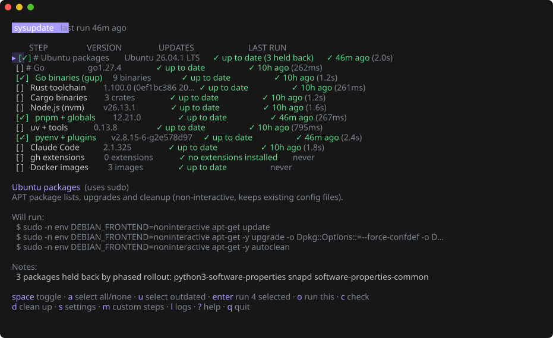
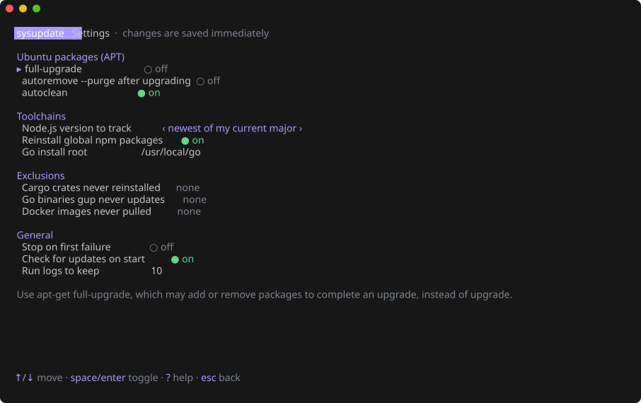

# sysupdate

A Go + [Bubble Tea](https://github.com/charmbracelet/bubbletea) terminal app: one command to update the whole WSL/Ubuntu dev environment, with an overview of what's outdated, per-step selection, live logs and run history.



<details>
<summary>Settings screen</summary>



</details>

The full user guide is in [HELP.md](HELP.md). It is built into the binary: press `?` in the TUI, or run `sysupdate help --full`.

## Steps

| ID | What it does | sudo |
|---|---|---|
| `apt` | `apt-get update`, `full-upgrade` (or `upgrade`), optional `autoremove --purge` / `autoclean`. Non-interactive, keeps existing config files | yes |
| `go` | Latest stable Go from the go.dev JSON feed, SHA256-verified, replaces `/usr/local/go` | yes |
| `gup` | `gup update` for `go install` binaries (skips `gup.exclude`); runs after `go` so tools get rebuilt with a new Go | |
| `rustup` | `rustup update` | |
| `cargo` | `cargo install --locked <crate>` for every crates.io install (git/path installs and `cargo.exclude` are skipped) | |
| `node` | `nvm install <current major or lts/*> --reinstall-packages-from=current` (skipped when already on the newest release), sets the nvm default, and puts it on PATH for later steps | |
| `pnpm` | `pnpm self-update`, `pnpm update -g` | |
| `uv` | `uv self update`, `uv tool upgrade --all` | |
| `pyenv` | `pyenv update` if the plugin exists, else `git pull --ff-only` | |
| `claude` | `claude update` | |
| `gh-ext` | `gh extension upgrade --all` (gh itself updates through APT) | |
| `docker` | `docker pull` for pulled images whose registry has a newer build (skips locally built images and `docker.exclude`). Off by default | |
| custom | Your own `bash -c` commands from the config | optional |

Each step also has a read-only **check**: a simulated APT upgrade (phased updates count as held back), go.dev, `gup check`, `rustup check`, the crates.io sparse index, nodejs.org, the npm registry, `pnpm outdated -g`, `uv tool list --outdated`, `git fetch` for pyenv, `gh extension upgrade --dry-run`, and registry digests for Docker. Checks also report leftovers worth removing (unused APT packages, leftover package configs, old nvm Node versions, untagged Docker images). They are removed only when you ask: `d` in the TUI or `sysupdate clean`.

Steps run one after another. A failing step doesn't stop the rest unless you turn on *Stop on first failure*.

## Install

Requires Go 1.26 or newer.

```bash
go install github.com/guiltydot/sysupdate-cli/cmd/sysupdate@latest
```

Prebuilt Linux binaries (amd64, arm64) with checksums are attached to each [GitHub Release](https://github.com/guiltydot/sysupdate-cli/releases).

Or from a clone:

```bash
make install        # builds and installs to ~/.local/bin/sysupdate
```

## Versioning

sysupdate follows [Semantic Versioning](https://semver.org). Releases are git tags `vMAJOR.MINOR.PATCH`, and changes are listed in [CHANGELOG.md](CHANGELOG.md). `sysupdate version` prints the version it was built from: a tag such as `v0.1.0`, or for builds between tags something like `v0.1.0-3-gabc1234`.

Releases are cut automatically from the commit history. Commit messages follow [Conventional Commits](https://www.conventionalcommits.org), and the type decides the bump:

| Commit | Bump |
|---|---|
| `feat: …` | minor |
| `fix: …`, `perf: …`, `refactor: …` | patch |
| `feat!: …` or a `BREAKING CHANGE:` footer | major (minor while the version is 0.x) |
| `docs:`, `test:`, `ci:`, `build:`, `chore:`, `style:` only | no release |

Each change also gets a line under `## [Unreleased]` in the changelog. Then:

```bash
make next-version   # show the version the commits call for
make release        # vet, tests, govulncheck; date the changelog; commit; tag
git push origin main vX.Y.Z
```

`BUMP=major|minor|patch make release` overrides the decision. Pushing a `v*` tag runs the release workflow, which tests the code, builds Linux binaries (amd64 and arm64) and publishes a GitHub Release with that version's changelog notes.

## TUI

Run `sysupdate`.

- **Overview**: one row per step with its enabled checkbox, installed version, pending updates and last run result. The panel under the table shows the highlighted step's commands and the list of pending updates.
  `space` toggle · `a` all/none · `u` select only outdated · `enter` run selected · `o` run only the highlighted step · `c`/`C` check all/this · `d` clean up leftovers · `s` settings · `m` custom steps · `e` edit config · `l` logs · `?` help · `q` quit
- **Run**: progress bar, status for each step, and live output that redraws `\r` progress lines in place. `↑/↓` view another step's output · `f` follow the running step · `X`/`ctrl+c` cancel (kills the process group) · `r` retry failed steps afterwards.
- **Settings** (`s`): one page with every setting (APT, Node, Go root, exclusions, general). Toggle with space, change choices with ←/→, edit text with enter. Changes save immediately.
- **Custom steps** (`m`): add, edit, delete and reorder your own commands, with forms.
- **Logs**: browse earlier run logs (`←/→`).

If any selected step needs sudo, the TUI hands the terminal to `sudo -v` before the run starts. During the run it keeps the sudo timestamp fresh. Child commands use `sudo -n`, so a missing password makes the command fail instead of hanging.

## CLI (scripts and cron)

Output is styled with [Lip Gloss](https://github.com/charmbracelet/lipgloss): coloured step headings and rounded summary tables for `run`, `check` and `list`. Colours are dropped automatically when output is piped or `NO_COLOR` is set.

```bash
sysupdate run                    # enabled steps, plain output, exit 1 if any step failed
sysupdate run --only apt,go
sysupdate run --skip cargo --dry-run
sysupdate check                  # what has updates
sysupdate clean                  # remove leftovers (asks first; --yes, --dry-run, --only)
sysupdate list                   # IDs, enabled, installed, versions, last run
sysupdate config [path|init|edit]
sysupdate logs [-n 2] [-list]
```

## Config

`~/.config/sysupdate/config.yaml` (override with `SYSUPDATE_CONFIG`). The file is created the first time you change a setting, or with `sysupdate config init`.

```yaml
enabled:            # missing IDs default to on
  cargo: false
apt: {full_upgrade: true, autoremove: false, autoclean: false}
go: {root: /usr/local/go}
cargo: {exclude: [some-crate]}
gup: {exclude: [some-binary]}
node: {channel: current-major, reinstall_packages: true}   # channel: current-major | lts
general: {stop_on_failure: false, check_on_start: true, keep_logs: 20}
custom:
  - id: flatpak
    name: Flatpak
    command: flatpak update -y
    requires: flatpak          # hidden as "not installed" if missing
    version: flatpak --version
  - id: snap
    name: Snaps
    command: snap refresh
    sudo: true
```

Run history and logs are kept in `~/.local/state/sysupdate/` (`state.json`, `logs/`).

## License

[MIT](LICENSE)
